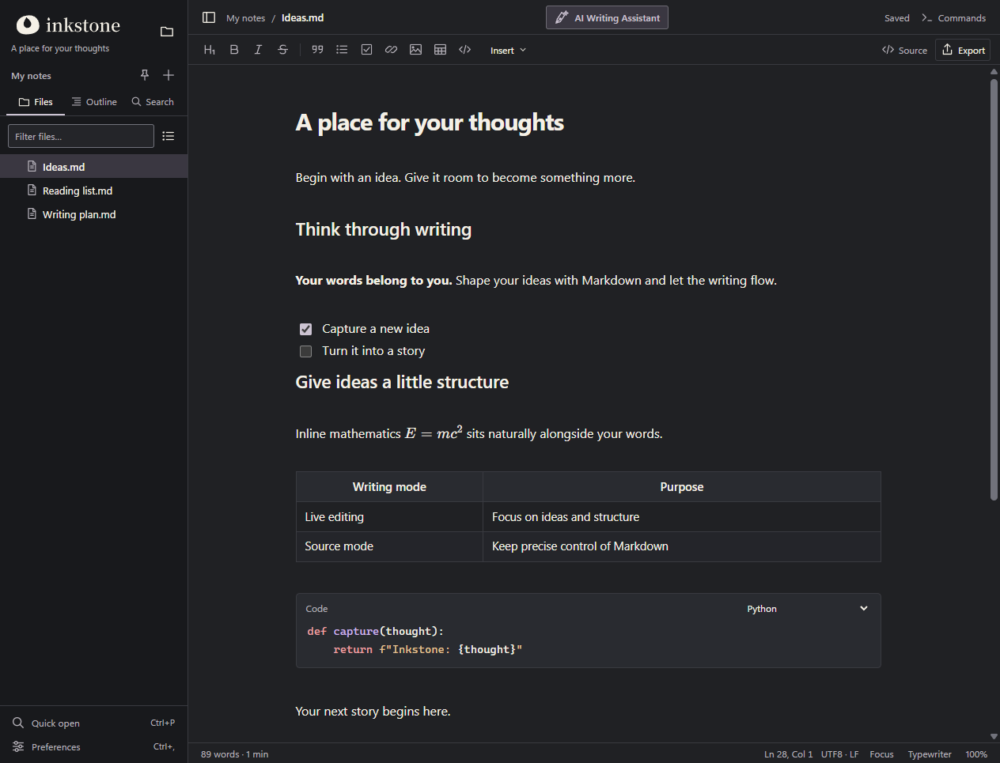
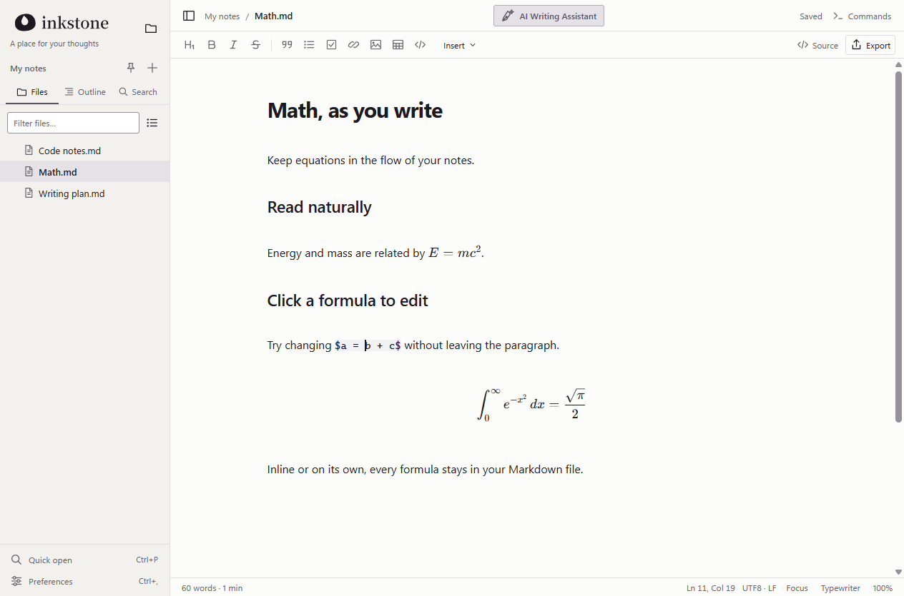
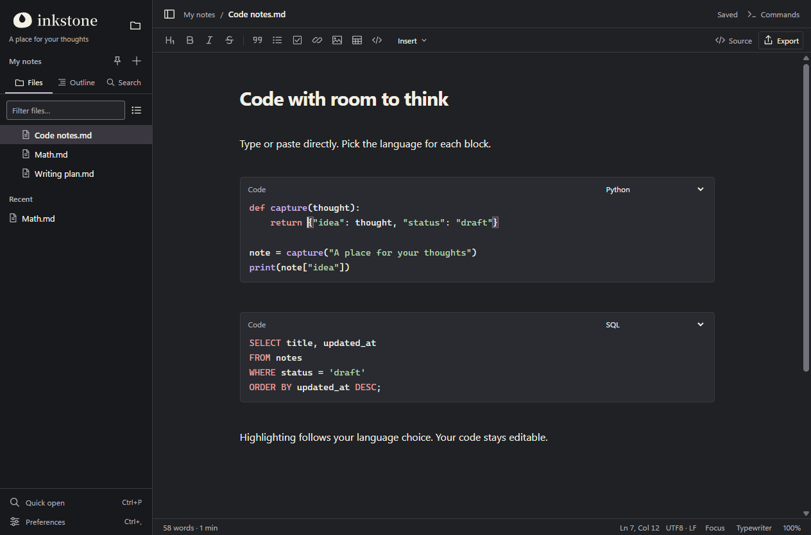
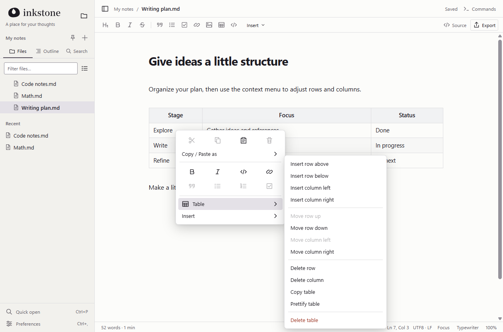

<p align="center">
  <picture>
    <source media="(prefers-color-scheme: dark)" srcset="docs/images/inkstone-logo-horizontal-reversed.png">
    
  </picture>
</p>

<p align="center"><strong>A place for your thoughts</strong></p>
<p align="center">English · <a href="README.zh-CN.md">简体中文</a></p>
<p align="center"><a href="https://wei2hu0.github.io/inkstone-website/index.html">Visit the official website ↗</a></p>

Inkstone is a local Markdown editor for focused writing. Your notes stay as ordinary files on your computer.



## Download

**[Download the latest Windows installer](https://github.com/JhuoW/Inkstone/releases/latest)**

Run the installer to install or upgrade Inkstone. Choose it from **Open with** for Markdown files, or use **Tools → Default Markdown app** to open Windows default-app settings.

## Features

- Live Markdown editing with a source mode that preserves selection and undo history.
- Inline formulas, LaTeX math blocks, Mermaid diagrams, and editable tables.
- Persistent code blocks with syntax highlighting and a language picker.
- Local folders, search, autosave, recovery, and HTML/PDF export.
- English and Simplified Chinese interfaces, light and dark themes.

### Math, as you write

Formulas render in place. Click to edit the expression directly in your paragraph.



### Code that stays editable

Type or paste into a code block, then choose its language for syntax highlighting.



### Tables, a right-click away

Insert a table or use its context menu to add, move, and remove rows and columns.



## Development

Requires **Node.js 22.12+**. Windows is the primary release platform; Linux source builds are also available.

```sh
npm ci
npm start
```

Use `npm test` for unit tests and `npm run dist:win` to build the Windows installer. See [validation notes](docs/RELEASE_0_6_4.md) and the [Electron API](electron/API.md) for details.

## License & contributor

[AGPL-3.0-only](LICENSE) · [Third-party notices](THIRD_PARTY_NOTICES.md) · [Wei Zhuo](https://wei2hu0.github.io/)
