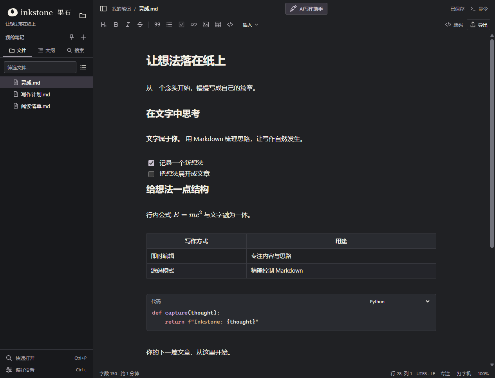
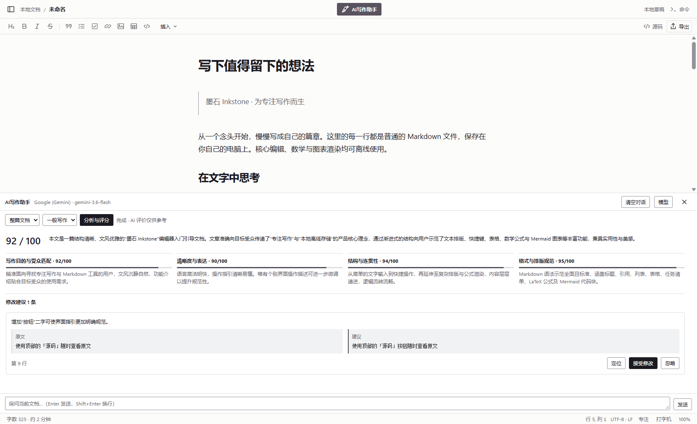
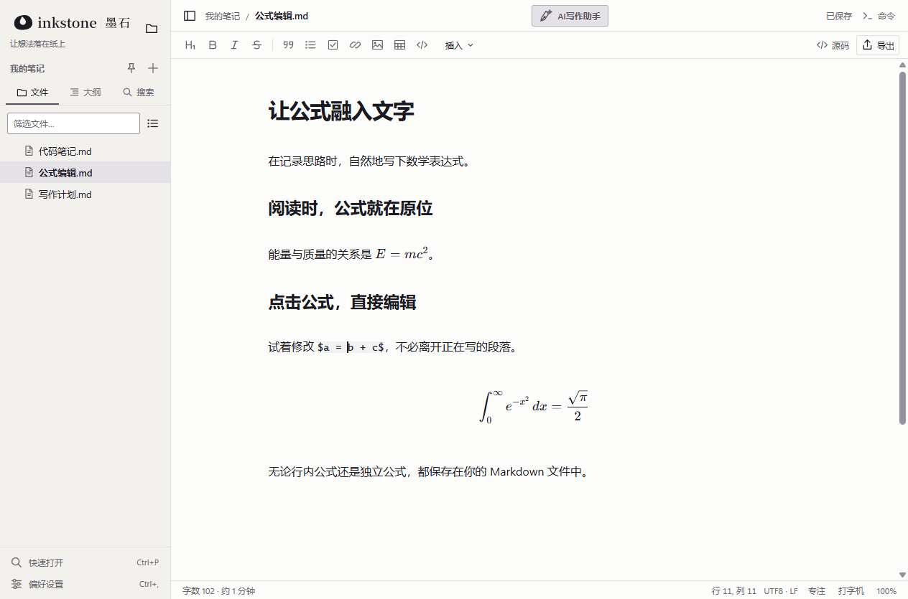
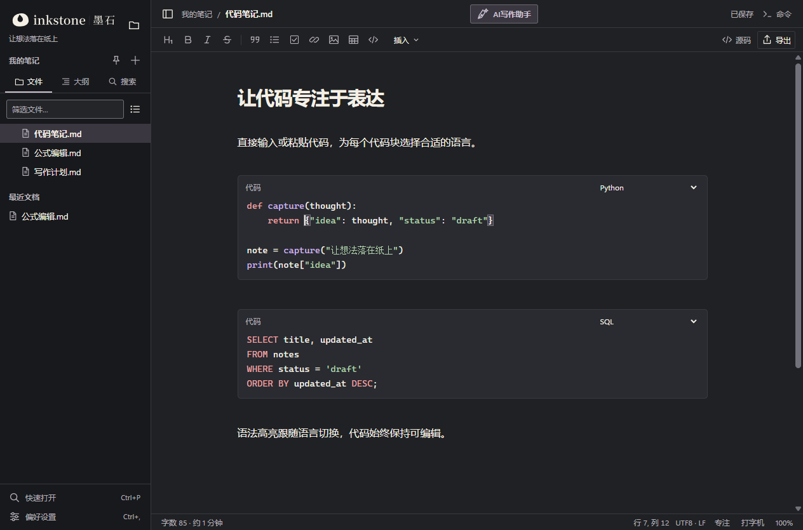
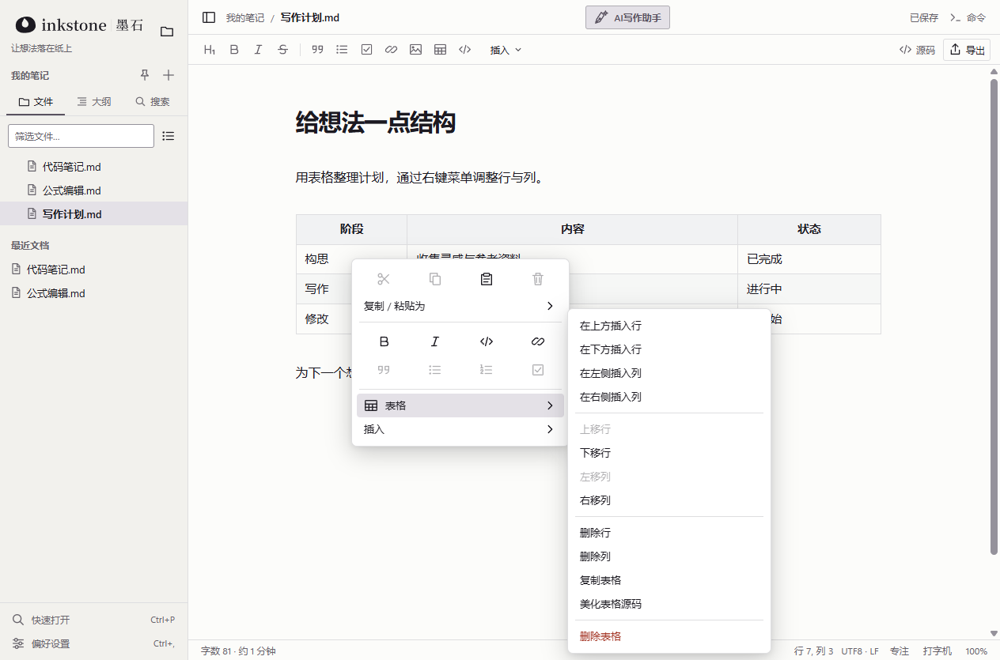

<p align="center">
  <picture>
    <source media="(prefers-color-scheme: dark)" srcset="docs/images/inkstone-logo-horizontal-reversed.png">
    
  </picture>
</p>

<p align="center"><strong>让想法落在纸上</strong></p>
<p align="center"><a href="README.md">English</a> · 简体中文</p>
<p align="center"><a href="https://wei2hu0.github.io/inkstone-website/zh.html">访问墨石官网 ↗</a></p>

墨石是一款 **AI 大模型驱动的本地 Markdown 编辑器**，支持专注写作、智能文档分析、评分与修改建议。你的笔记始终以普通文件保存在自己的电脑上。



## 下载

**[下载最新 Windows 安装版](https://github.com/JhuoW/Inkstone/releases/latest)**

运行安装程序即可安装或升级。右击 Markdown 文件，在“打开方式”中选择 Inkstone；也可通过“工具 → 默认 Markdown 应用”打开 Windows 默认应用设置。

## 功能

- [AI写作助手](docs/AI_ASSISTANT.md)：支持本地模型、OpenAI、Claude、Gemini、DeepSeek 等 11 种接入，自动发现模型，在底部面板中分析评分、对话，并确认应用修改建议。
- Markdown 即时编辑，输入 `/` 即可插入各类内容；源码模式保留选区和撤销记录。
- 行内公式、LaTeX 公式块、Mermaid 图表与可直接编辑的表格。
- 持续显示的代码块，支持语法高亮与语言下拉选择。
- 本地文件夹、搜索、自动保存与恢复；可导出 PDF、HTML 和图片，配合 Pandoc 还可导出 Word 等格式。
- 简体中文和英文界面，浅色与深色主题，以及沉浸模式。

### AI写作助手

分析文档，获得总分、分项评价与修改建议。每条修改都先经你确认，再应用到文档。



### 让公式融入文字

公式在原位渲染，点击即可在当前段落中直接编辑表达式。



### 始终可编辑的代码块

直接输入或粘贴代码，选择语言即可获得对应的语法高亮。



### 右键就能编辑表格

插入表格后，通过右键菜单添加、移动或删除行与列。



## 开发

需要 **Node.js 22.12+**。主要发布 Windows 版本，也可从源码构建 Linux 版本。

```sh
npm ci
npm start
```

使用 `npm test` 运行单元测试，`npm run dist:win` 构建 Windows 安装程序。详细信息见 [0.9.1 发布记录](docs/releases/v0.9.1.md)、[架构说明](docs/ARCHITECTURE.md)和 [Electron API](electron/API.md)。

## 许可证与贡献者

[AGPL-3.0-only](LICENSE) · [第三方许可](THIRD_PARTY_NOTICES.md) · [Wei Zhuo](https://wei2hu0.github.io/)
