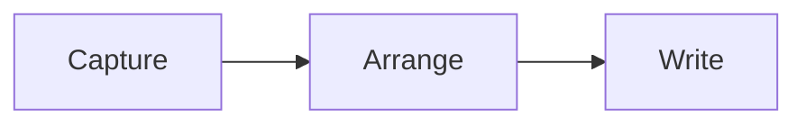

# A quieter place to think

Good tools leave room for the work. Inkstone keeps **your words** at the centre — 从一个想法，到一篇完整的文章。

## Notes in progress

A useful equation, $\frac{x^2}{2} + y$, belongs in the sentence. Every symbol can be edited in place.

- [x] Keep the original Markdown intact
- [x] Make everyday commands easy to find
- [ ] Leave space for the next idea

> Clarity comes from deciding what deserves attention.

## Working with structure

| Material | Purpose | Status |
| :--- | :--- | :---: |
| Notes 中文 | Capture an idea | Draft |
| References | Keep the source | Ready |

```javascript
const draft = { title: "A quieter place", local: true };
await notebook.save(draft);
```

## Thinking in systems

$$
\int_0^1 x^2\,dx = \frac{1}{3}
$$




## Next steps

Keep writing. The file stays yours.
