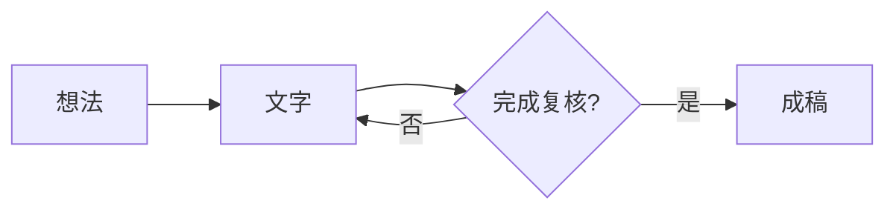
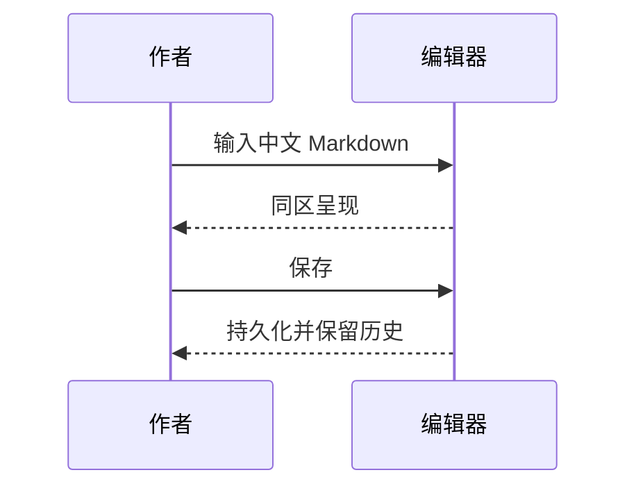
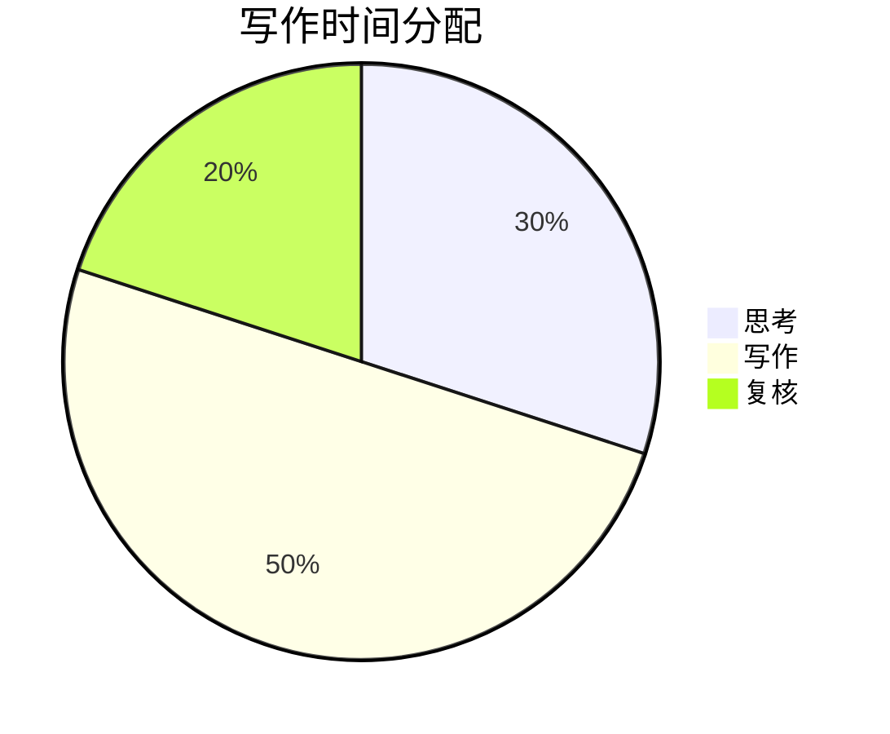
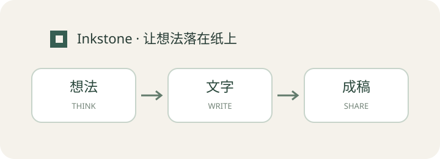

# 墨石 · 日常写作验收样例

这份文档是**功能测试素材**，不是全部功能已经通过的证明。实际结果以 [验收记录](../docs/ACCEPTANCE.md) 和 [功能矩阵](../FEATURE_PARITY.md) 为准。测试前请复制整个 `samples` 文件夹，保留资源相对路径。有意错误与安全负例独立放在 [error-cases.md](error-cases.md)，本文件用于正常完整渲染和导出。

[TOC]

## 一、中文、排版与编辑

春天的雨落在窗边，我们把想法写成文字。你好，世界！中文标点：，。；：“”‘’（）《》——……。English words, café, naïve, Ελληνικά, العربية，🙂👨‍👩‍👧‍👦。

这一段包含 **粗体**、*强调*、~~删除线~~、==高亮==、`inline_code()`、H~2~O 与 x^2^，以及 <u>下划线</u>。

中文**紧邻强调**测试，混合 *English emphasis* 和 `代码`。Emoji：:smile: :heart: :rocket: :sparkles:。

这是一行软换行，
下一行应按当前换行设置显示。

这一行结尾保留两个空格。  
这是一处 Markdown 硬换行。

多个    空格、制表符	和结尾空白都属于原始文档内容。

> 引用：写作是一种思考。
>
> 第二段引用有 **强调**。
>
> > 嵌套引用，测试连续输入和退出引用。

### 嵌套列表

1. 第一章：准备
   - 找到一个问题
   - 列出思路
     1. 保留证据
     2. 写出判断
2. 第二章：动笔
   - [ ] 写第一稿
   - [x] 备份素材
   - [ ] 检查中文、公式与图片

- 列表中的第一段。

  列表中的第二段，保留四周的空白。

  ```javascript
  const greeting = '你好，世界';
  console.log(greeting);
  ```

### 提示块

> [!NOTE]
> 记录事实和来源。

> [!TIP]
> 保持原文与呈现分离。

> [!IMPORTANT]
> 修改冲突时保留编辑内容。

> [!WARNING]
> 未验证的平台不能写成“已完成”。

> [!CAUTION]
> 对副本执行删除与故障测试。

## 二、链接、锚点与脚注

[回到中文编辑](#一中文排版与编辑)，[跳转到另一个文件](linked-note.md#跨文件目标)，[引用式链接][inkstone-reference]，自动链接 https://example.org 。

这是一条脚注[^writing]，还有一个带格式的脚注[^details]。

[^writing]: 先写下来，再慢慢修改。
[^details]: 支持 **格式** 的说明；脚注本身也需要往返保真。

[inkstone-reference]: https://example.org "示例站点；不会自动联网"

### 重复标题

第一处同名标题。

### 重复标题

第二处同名标题。[跳到第二处](#重复标题-1)。

## 三、表格

| 项目 | 数量 | 进度 |
| :--- | ---: | :---: |
| 中文写作 | 12 | **完成** |
| 表格编辑 | 3 | 进行中 |
| 转义管道 \| | 1 | `a\|b` |
| [本地链接](linked-note.md) | 2 | ==复核== |

可在表格中测试 Tab、Shift+Tab、增删行列、移动和对齐。下面是供粘贴测试的 TSV（复制代码块内内容）：

```text
名称	数量	备注
铅笔	2	中文
纸张	10	A4
```

## 四、数学与化学

行内公式：$E = mc^2$，$\alpha + \beta = \gamma$，$\frac{1}{2} + \frac{1}{3} = \frac{5}{6}$。货币 $20 和 $30 不应误当公式。

$$
\int_0^1 x^2\,dx = \frac{1}{3}
$$

$$
\begin{aligned}
f(x) &= x^2 + 2x + 1 \\
     &= (x+1)^2
\end{aligned}
\tag{1}\label{eq-square}
$$

交叉引用：$\eqref{eq-square}$。编号和引用是否与 Typora 完全一致需独立验收。

化学：$\ce{2H2 + O2 -> 2H2O}$，单位：$\pu{25 °C}$。

## 五、代码与图表

```python
from pathlib import Path

def write_note(name: str) -> str:
    """中文注释和字符串不能乱码。"""
    return f"你好，{name}"

print(write_note("墨石"))
```

```unknown-language
未知语言围栏：必须保留文字，不能丢失或执行。
```







### 传统图表兼容探针

以下检查旧图表语法。当前使用 flowchart.js / js-sequence 原语法引擎；复杂语法、所有选项以及simple/hand主题需分别验收。

```flow
st=>start: 开始
op=>operation: 写作
cond=>condition: 完成?
e=>end: 结束
st->op->cond
cond(yes)->e
cond(no)->op
```

```sequence
Alice->Bob: Hello, Markdown!
Bob-->Alice: 你好，墨石
```

## 六、图片与媒体

这张图及媒体由本项目原创生成，使用相对路径，无网络依赖。




音频（半秒钟轻音，手动播放）：

<audio controls src="assets/tone.wav"></audio>

视频（一秒钟原创几何图形，手动播放）：

<video controls width="480" src="assets/inkstone-bars.webm"></video>

PDF/图片不具有音视频播放功能；应核对静态占位或替代说明。HTML 中媒体播放需单独检查。

## 七、HTML、注释与分页

<span style="color:#365e52">带颜色的中文</span>，<kbd>Ctrl</kbd> + <kbd>S</kbd>，<ruby>墨<rt>mò</rt>石<rt>shí</rt></ruby>，实体 &amp; &lt; &gt; &copy;。

<details>
<summary>展开后检查 HTML 内容</summary>
<p>这是折叠区中的中文段落。源码应保持原样。</p>
</details>

<!-- 这是一条只应保留在源码中的注释，导出可见正文不应出现它。 -->

<div style="page-break-after: always;"></div>

### 分页后的内容

导出 PDF 后核对本标题、上图和表格是否被不合理截断。中文、拉丁字母、数学和图形均应可辨认。

## 八、保真与不支持语法探针

:::unknown-extension
此扩展语法未知时应作为原文保留。
不能因为渲染器不认识就删除它。
:::

以下仅用于兼容性检查；显示普通源文或错误必须记录，不能把它当作通过。

LaTeX 定界符：\(a^2+b^2=c^2\)。

```math
x = \frac{-b \pm \sqrt{b^2-4ac}}{2a}
```

<custom-element custom-attribute="preserve-me">未知 HTML 标签及属性应在源文件中保留。</custom-element>

结束标记：**INKSTONE-END-中文-2026**。
