# Mermaid 离线图表验收

25种图表的基础中文夹具。完整类别结果和边界见[验收说明](../docs/MERMAID_CATALOG.md)。这些示例均使用本地打包渲染器，不加载远程字体或图标。

## flowchart


## sequenceDiagram

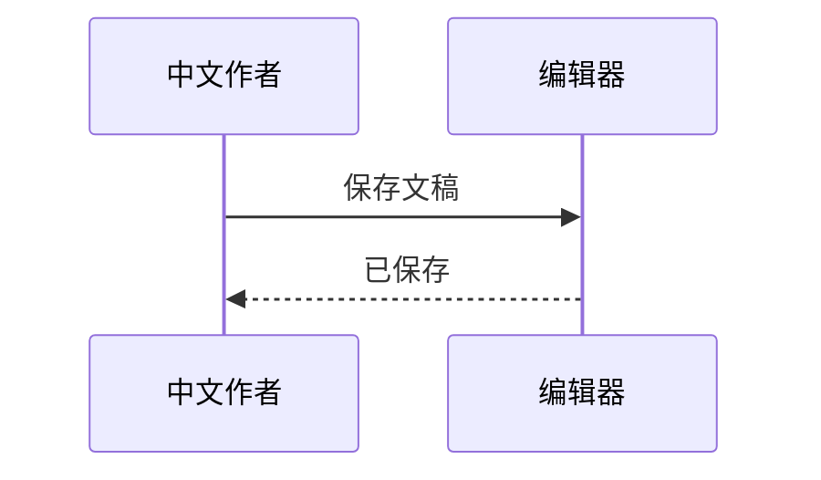

## gantt

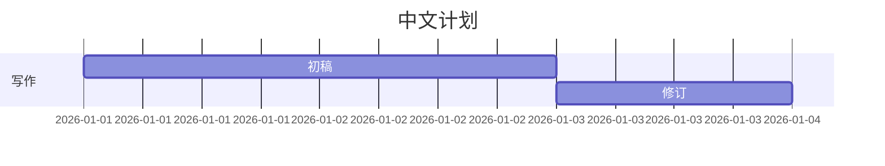

## classDiagram

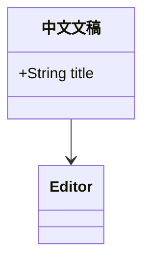

## stateDiagram

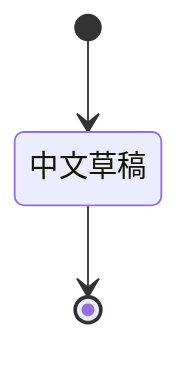

## pie

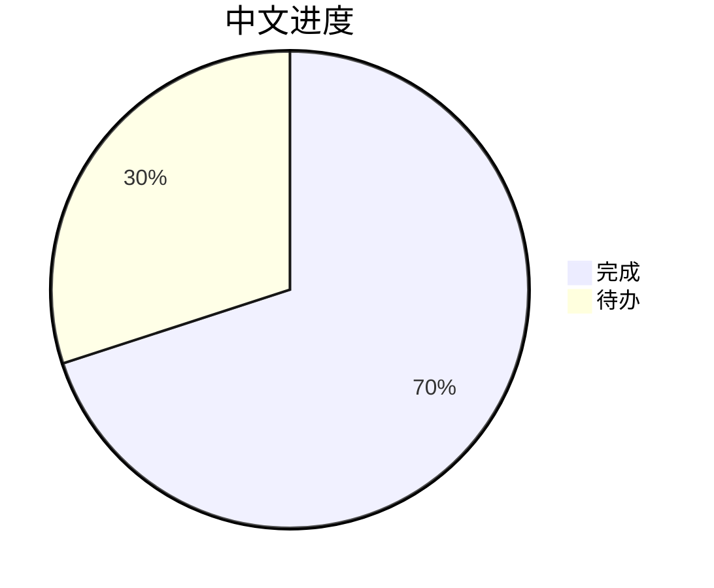

## requirementDiagram

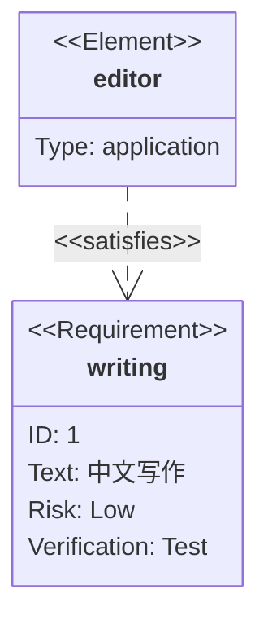

## gitGraph

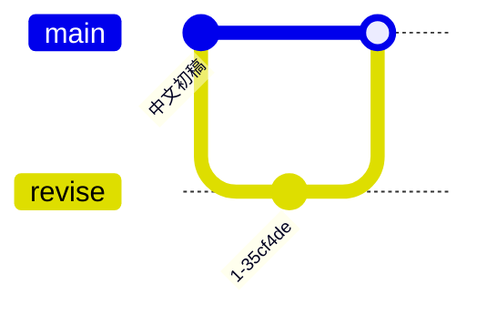

## C4Context

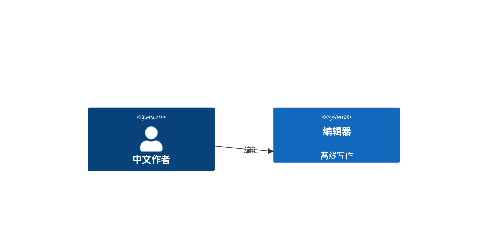

## mindmap

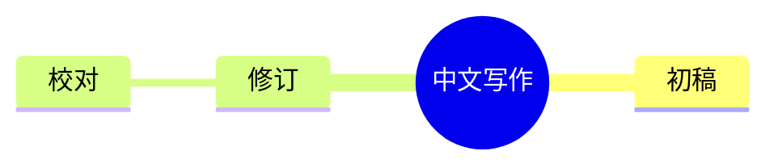

## timeline

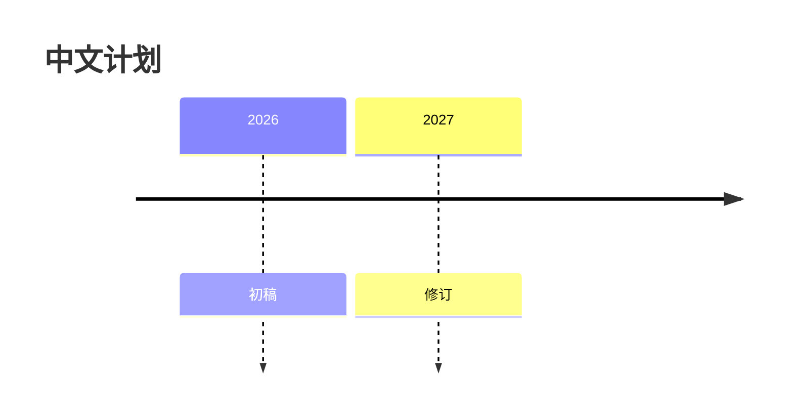

## quadrantChart

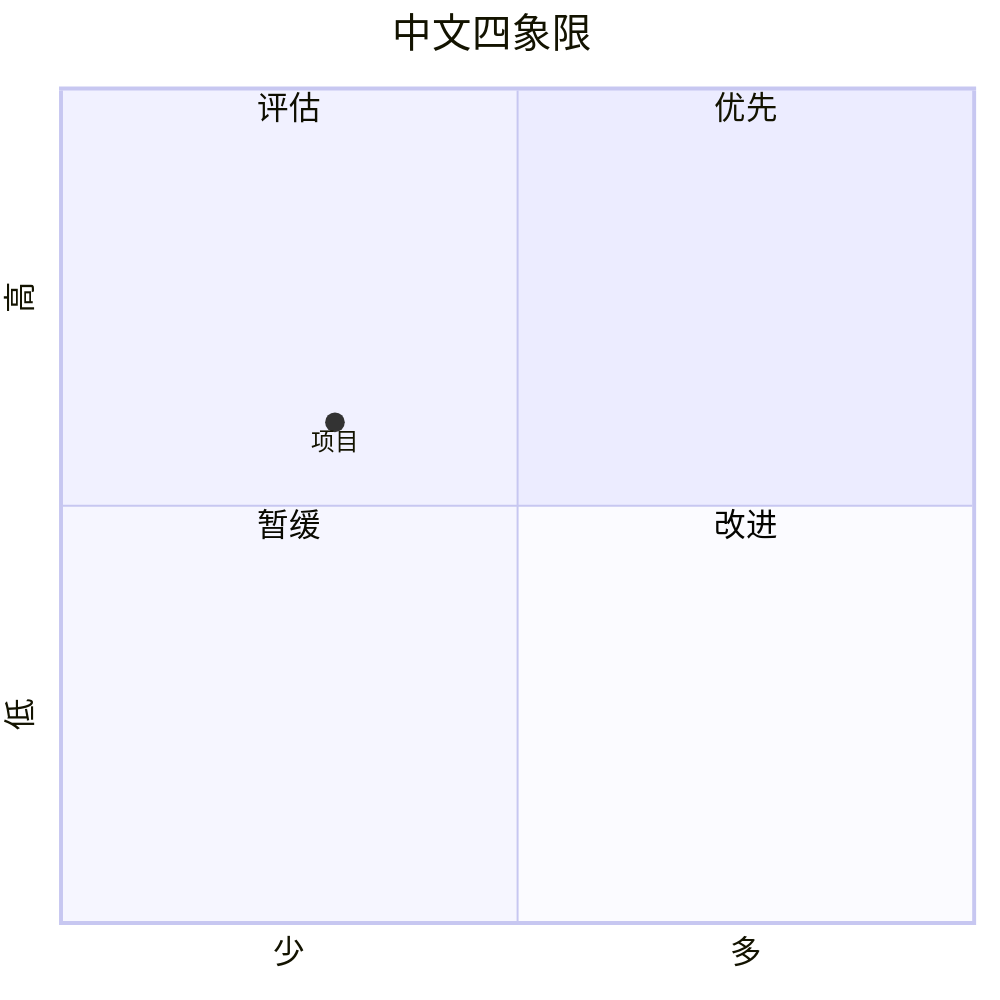

## sankey

```mermaid
sankey-beta

"中文输入","编辑",20
"编辑","输出",15
"编辑","草稿",5
```

## xychart

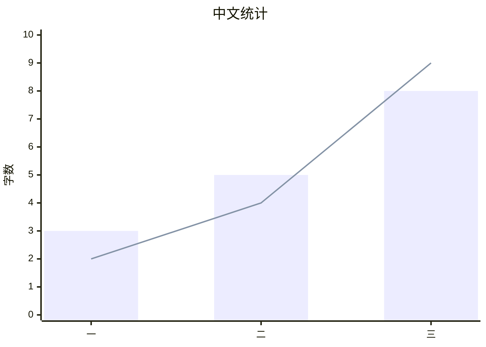

## block


## radar

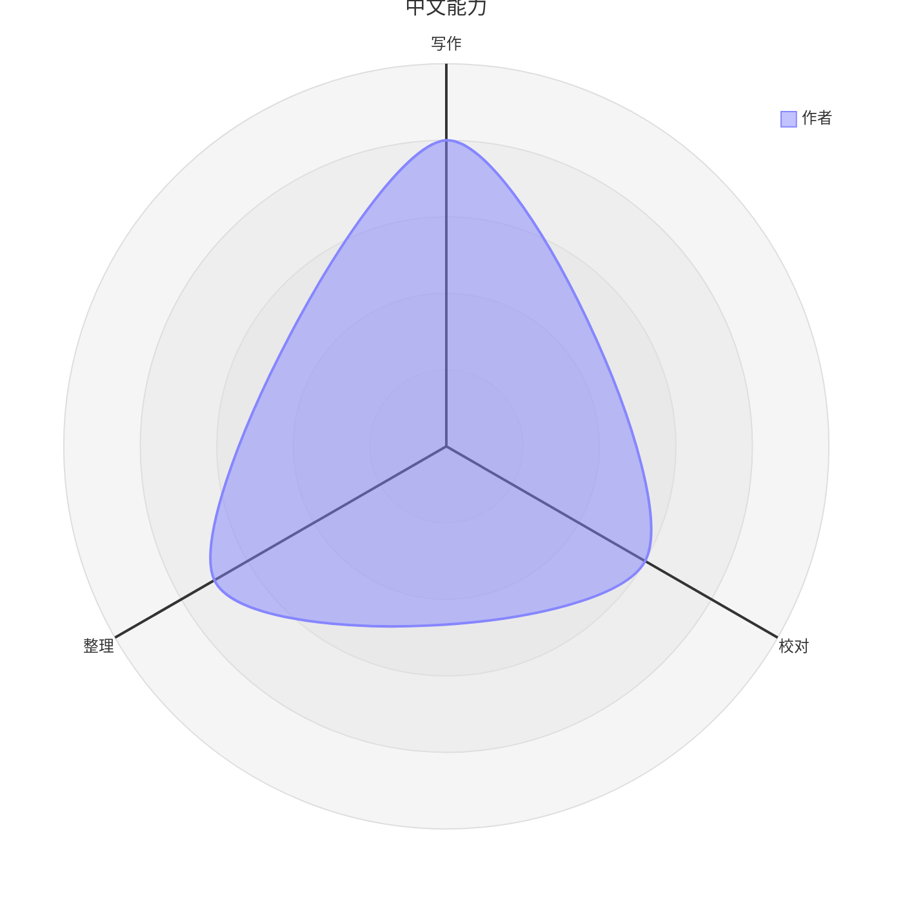

## treemap

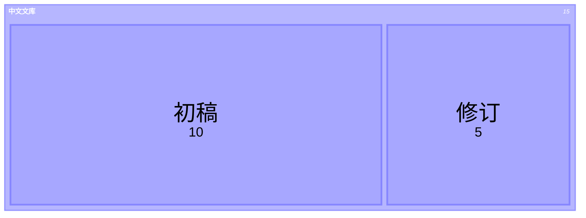

## packet

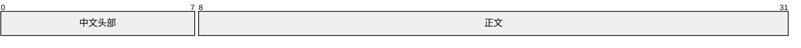

## kanban


## architecture


## venn

```mermaid
venn-beta
set A["中文写作"]
set B["阅读"]
union A,B["思考"]
```

## ishikawa

```mermaid
ishikawa-beta
    中文写作问题
    内容
        缺少例子
    结构
        顺序混乱
```

## erDiagram

```mermaid
erDiagram
AUTHOR ||--o{ DOCUMENT : "中文创作"
DOCUMENT {
string title
}
```

## journey

```mermaid
journey
title 中文写作流程
section 起步
拟提纲: 5: 作者
写初稿: 4: 作者
```

## zenuml

```mermaid
zenuml
title 中文协作
Author->Editor: 保存文稿
```

